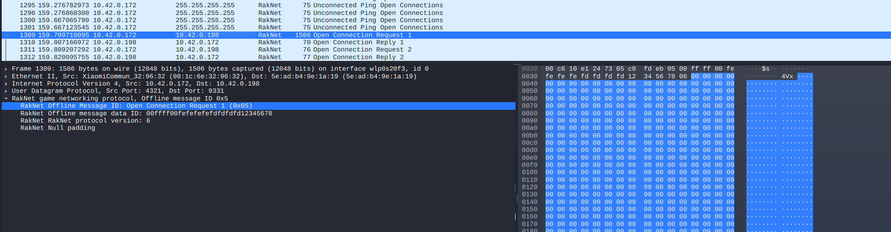
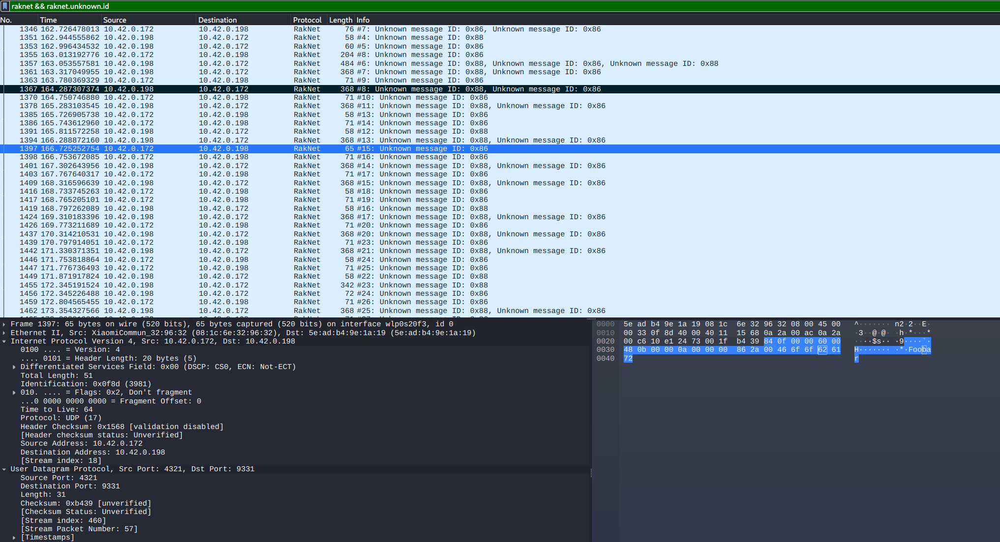

> This post demonstrates the reverse engineering of an app to understand its internal workings. It is intended purely for educational purposes and does not promote or encourage online hacking or any malicious activities.
{: .prompt-info }


### Intro

Hii Everyone, I have been fiddling with mobile game hacking tools recently. Some tools include Lucky Patcher, Game guardian, [AceTheGame](https://github.com/KuhakuPixel/AceTheGame). These tools work perfectly for offline games patching memory in runtime or modifying dex code for money and health hacks. But then I wanted to tweak with some online game. Since Mini militia offers both online and LAN mode games, I selected it as it will be easier for debugging. I started like always with apk decompilation jadx. Intial analysis reveals that the app uses cocos2d as game engine as lib/arm64-v8a contains **libcocos2dcpp.so**. 


### Black Box scan

My intial approach is to capture the traffic and analyze the packets prior to source code analysis. The application uses [raknet](https://github.com/facebookarchive/RakNet). Since it used UDP as underlying protocol. Since this is UDP based traffic, burp suite won't work here unless used with some extension like [NoPE proxy](https://portswigger.net/bappstore/12e84399d46a408dbe970f181391f781). Mitmproxy have support for UDP traffic capture but I used wireshark to capture the traffic hoping that it doesn't encrypt packets. Wirehark has support for filtering and displaying raknet protocol traffic. Since [ref](https://www.wireshark.org/docs/dfref/r/raknet.html). Applying only `raknet` filter displays ony Raknet packets. The raknet packet identifiers filters `raknet.offline.message.id` are useful in filtering specific packets which are mentioned [here](https://github.com/facebookarchive/RakNet/blob/master/Source/MessageIdentifiers.h#L233)


{:style="display:block; margin-left:auto; margin-right:auto;width=50%;height=70%"}


I created a LAN match and make my other device join the same room and generated some traffic. Sending chat messages, changing game configurations and playing a short game to generate more traffic. The game specific packets doesn't follow a stand raknet packets identifier, using filter `raknet && raknet.unknown.id`, I was able to see the chat message  **foobar** in the traffic. Similar to this other traffic is also cpatured as unknow message id. With this information let's try to understand the traffic structure and decode it.  


{:style="display:block; margin-left:auto; margin-right:auto;width=50%;height=70%"}


### White Box scan

I loaded the library in ghidra and started analyzing the functions. I analyzed all functions and found lot of raknet functions used inside binary, Apart from this I needed a pivot point to start my reversing, I started with `ServerState::processServerPackets `.


```c
void _ZN11ServerState20processServerPacketsEv(long param_1)

{
  ...
  
  lVar3 = tpidr_el0;
  lVar3 = *(long *)(lVar3 + 0x28);
  local_70 = *(long **)(param_1 + 0x10);
  (**(code **)(*local_70 + 200))();
  while( true ) {
    if (local_70 == (long *)0x0) {
      lVar2 = tpidr_el0;
      if (*(long *)(lVar2 + 0x28) == lVar3) {
        return;
      }
    }
  }
}
```

As the first param is dereferenced and used for calling methods. It is clear that param_1 represents an VTable object. So I analyzed the same using this frida script to understand what does it represents.

```javascript
const MODULE   = 'libcocos2dcpp.so';
const SYM      = '_ZN11ServerState20processServerPacketsEv';
const PEER_OFF = 0x10;

function hook(){
    const gameEngine = Process.getModuleByName(MODULE);
    const p = gameEngine.getExportByName(SYM)
    const addr = p;
    const base = gameEngine.base;
    // for finding the offset from base address
    const gh = (p) => 'off:0x' + p.sub(base).toString(16);

    Interceptor.attach(addr, {
        onEnter(args) {
        const self = args[0];
        let peer = ptr(0), vt = ptr(0);
        try { peer = self.add(PEER_OFF).readPointer(); } catch (e) {}
        try { vt = peer.isNull() ? ptr(0) : peer.readPointer(); } catch (e) {}
        
            console.log('\n[processServerPackets] #' + n);
            console.log('this (ServerState*) = ' + self + '  (' + gh(self) + ')');
            console.log('this+0x10 peer      = ' + peer + (peer.isNull() ? '' : '  (' + gh(peer) + ')'));
            console.log('peer->vtable        = ' + vt +
                        (vt.isNull() ? '' : '  ' + DebugSymbol.fromAddress(vt))); 
            console.log(" address is "+gh(vt))
            // prints 0x1369f50
            // leads to hex(0x1369f50 + 0x100000) => 0x1469f50
        }
    });
};

if (!hook()) {
  console.log('starting');
  const iv = setInterval(() => { if (hook()) clearInterval(iv); }, 200);
}
```


`0x1469f50` address represents raknetPeer vtable whose methods closely resembles this [raknetpeerinterface.h](https://github.com/facebookarchive/RakNet/blob/1a169895a900c9fc4841c556e16514182b75faf8/Source/RakPeerInterface.h) file, but it also lists additional methods other. 

{:style="display:block; margin-left:auto; margin-right:auto;width=50%;height=70%"}

Since there are lot of branch instructions ghidra struggled with disassembly so I used online arm [diassembler](https://ret.futo.tech/arm64/) to view instruction code instead of ghidra's disassembler. I analyzed each and every branch instruction since the code indicates multiple branch, I found branch to  `_ZN11ServerState17ClientPeerMessageEPN6RakNet6PacketE` from the address. I hooked this but I didn't received any calls in this methods. Maybe because I was trying to be host in local game, this method is not used. So I tried next branch and it points to `_ZN11ServerState22ClientBroadcastMessageEPN6RakNet6PacketEbb`at address **0x4e9a30**. Adding 0x100000 [ghidra base address]to this address, we can inspect its function in ghidra.


{:style="display:block; margin-left:auto; margin-right:auto;width=50%;height=70%"}


I made similar script to debug the arguments passed here. This method already has call to `            _ZN11ServerState14ProcessMessageEPN6RakNet6PacketEP11ClientEntryb(param_1,param_2,lVar4,0)` which looks like base class for processing server message. Modified above script for 


```javascript
const SYM      = '_ZN11ServerState22ClientBroadcastMessageEPN6RakNet6PacketEbb';
...

const self = args[0];
const arg1  = args[1];
const arg2 = args[2];
const arg3 = args[3];

console.log('\n[ClientBroadcastMessage]');
console.log('this => ' + self + ' offset=>'+ gh(self));
console.log('debug => ' + DebugSymbol.fromAddress(self.readPointer()))
console.log('arg1 => ' + arg1 + ' offset=>'+ gh(self));
console.log('debug => ' + DebugSymbol.fromAddress(arg1.readPointer()))

// O/P
// [ClientBroadcastMessage]
// this => 0xb40000710ca32d20 offset=>off:0xb400000178629d20
// debug => 0x6f95755758 libcocos2dcpp.so!_ZTV9ServerLAN+0x10
// arg1 => 0xb40000710ca22628 offset=>off:0xb400000178629d20
// debug => 0x100007fe1100002
```

There are other two arguments but it looks like boolean and not necessary for now. It is clear that ServerLAN instance with +0x10 offset is passed as a pointer here. From ghidra it is evident that relocation table like `_ZTV9ServerLAN` which points to other methods. Applying c++filt to mangled name also helps in recovering the arguments type. So the first argument is Raknet::Packet pointer.

```bash
echo "_ZN11ServerState22ClientBroadcastMessageEPN6RakNet6PacketEbb" | c++filt     
ServerState::ClientBroadcastMessage(RakNet::Packet*, bool, bool)

echo "_ZN11ServerState14ProcessMessageEPN6RakNet6PacketEP11ClientEntryb" | c++filt 
ServerState::ProcessMessage(RakNet::Packet*, ClientEntry*, bool)
```


So the first argument `_ZTV9ServerLAN` pointer plus +0x18 is a object being queried from _ZTV9ServerLAN+0x18 [0x0144c748+0x18] and then the value from `_ZNK14DataStructures3MapIN6RakNet10RakNetGUIDEP11ClientEntryXadL_ZNS_23defaultMapKeyComparisonIS2_EEiRKT_S8_EEE3GetERKS2_` is passed as argument as ClientEntry * for ProcessMessage call.

```bash
echo "_ZNK14DataStructures3MapIN6RakNet10RakNetGUIDEP11ClientEntryXadL_ZNS_23defaultMapKeyComparisonIS2_EEiRKT_S8_EEE3GetERKS2_" | c++filt
DataStructures::Map<RakNet::RakNetGUID, ClientEntry*, &(int DataStructures::defaultMapKeyComparison<RakNet::RakNetGUID>(RakNet::RakNetGUID const&, RakNet::RakNetGUID const&))>::Get(RakNet::RakNetGUID const&) const

```


Again ServerState::ProcessMessage has inconsistent decompilation in ghidra, so I copied again the byte string and used online compiler. This time there are two branches with `blr` instruction others branches to other parts of same function. Starting with first blr call, it loads x9 from stack pointer which points to first argument + 0x10, which as already discovered a _ZTV9ServerLAN Vtable. It adds another 0x98 and calls what it is stored in that address which turns out to be `hex(0x0144c748 + 0x10 + 0x98) => '0x144c7f0'` **_ZN9ServerLAN20processPlayerMessageEPN6RakNet6**.

```
ldr x8, [sp, #0x10]
ldr x9, [x8]
ldr x9, [x9, #0x98]
ldur x1, [x29, #-0x18]
ldurb w2, [x29, #-0x28]
ldr x3, [sp, #0x30]
ldrh w4, [sp, #0x2c]
ldur x5, [x29, #-0x20]
mov x0, x8
blr x9
```

The second blr call was a little tricky, since the return type of ServerState::GetRoom returns **ClientRoomLAN**. A differenct object different than previous ServerLAN object. I stuck in this part for long time trying to look at different offset, but dynamic analysis gave a strong verdict that the return type is `_ZTV13ClientRoomLAN+0x10`. Same like previous script but this time hooked `_ZN11ServerState7GetRoomEP11ClientEntry` method and analyzed the input arguments and return type.

```javascript
function typeOf(p) {
  try {
    if (p.isNull()) return '(null)';
    return p + '   ' + DebugSymbol.fromAddress(p.readPointer());
  } catch (e) { return p + '   (unreadable)'; }
}

...
function hook(){
  const mod = Process.findModuleByName(MODULE);
  if (!mod) return false;
  const addr = mod.getExportByName(SYM);

  Interceptor.attach(addr, {
    onEnter(args) {
      this.self  = args[0];
      this.entry = args[1];
    },
    onLeave(retval) {
      const room = ptr(retval.toString());   // RETURN value = ClientRoom* (predicted)
      console.log('\n[GetRoom]');
      console.log('arg0 this         = ' + typeOf(this.self));
      console.log('arg1 ClientEntry* = ' + typeOf(this.entry));
      console.log('RET  room         = ' + typeOf(room));
    }
  });
  console.log('[+] hooked GetRoom @ ' + addr);
  return true;
}
...


//Output
//[GetRoom]
//arg0 this         = 0xb40000710ca34140   0x6f9834f758 libcocos2dcpp.so!_ZTV9ServerLAN+0x10
//arg1 ClientEntry* = 0xb4000070eca600c0   0x6f9834fa80 libcocos2dcpp.so!_ZTV11ClientEntry+0x10
//RET  room         = 0xb40000717ca99290   0x6f9834fab8 libcocos2dcpp.so!_ZTV13ClientRoomLAN+0x10

```

```
bl 0x5fc3c0                 // _ZN11ServerState7GetRoomEP11ClientEntry
str x0, [sp, #0x18]         // saves it in sp
ldr x0, [sp, #0x18]         // loads it in x0
cbz x0, 0x935a58            // null check
ldr x8, [sp, #0x18]         
ldr x9, [x8]                // not sure of it
ldr x9, [x9, #0x170]        // loads address from +0x170 -> which is _ZN13ClientRoomLAN20processPlayerMessage
ldur x1, [x29, #-0x18]
ldurb w2, [x29, #-0x28]
ldr x3, [sp, #0x30]
ldrh w4, [sp, #0x2c]
ldur x5, [x29, #-0x20]
mov x0, x8
blr x9                      // calls _ZN13ClientRoomLAN20processPlayerMessage with args

```

After decompiling `_ZN13ClientRoomLAN20processPlayerMessage` and `_ZN9ServerLAN20processPlayerMessageEPN6RakNet6`, these two two looks like the significant method where most of the call dispatcher happens. 

### _ZN9ServerLAN20processPlayerMessageEPN6RakNet6

 Since there are lot of branch statement here, ghidra threw error **too many branches to recover a jumptable** . So I used **claude** to generate a switch statement recovery from the Jump table. The disassembly shows that it loads offset address from `DAT_0118c3c0` as 32 bit int, these address hold the offset to be added to the current function base address. So it recursively reads byte at the address and add it to the base addres to point to current location.


```

from ghidra.program.model.symbol import RefType, SourceType
from ghidra.program.model.pcode import JumpTable
from java.util import ArrayList

JUMP = toAddr(0x929864)     # the `br x8` indirect branch
TBL  = toAddr(0x118c3c0)    # jump-table base in .rodata (s32 offsets from here)
N    = 0x25                 # 37 entries  (opcode = index + 7)

mem    = currentProgram.getMemory()
refmgr = currentProgram.getReferenceManager()
func   = getFunctionContaining(JUMP)
if func is None:
    print("No function contains 0x%x -- aborting" % JUMP.getOffset())
else:
    dests = ArrayList()
    seen  = set()
    for i in range(N):
        rel = mem.getInt(TBL.add(i * 4))        # signed 32-bit offset
        tgt = TBL.add(rel)                        # target relative to table base
        dests.add(tgt)
        # navigable COMPUTED_JUMP ref so the listing shows case arrows
        refmgr.addMemoryReference(JUMP, tgt, RefType.COMPUTED_JUMP,
                                  SourceType.USER_DEFINED, 0)
        if tgt.getOffset() not in seen:
            seen.add(tgt.getOffset())
            if getInstructionAt(tgt) is None:
                disassemble(tgt)


    # the key step: explicit override the decompiler will honor
    jt = JumpTable(JUMP, dests, True)
    jt.writeOverride(func)
    print("Override written: %d entries (%d unique targets) at 0x%x"
          % (N, len(seen), JUMP.getOffset()))
    print("Now re-decompile %s (press F5) to see the full switch(opcode)."
          % func.getName())
    try:
        from ghidra.app.decompiler import DecompInterface
        di = DecompInterface(); di.openProgram(currentProgram)
        di.decompileFunction(func, 30, monitor)
        di.dispose()
    except:
        pass
```


Load this script in ghidra, run it and decompile again for ghidra to process the switch case and its handling. The switch statements are recovered now and it decompiles correctly to show calls made to other methods.

```c
  case 0x23:
    _ZN9ServerLAN24processPlayerChatMessageEPN6RakNet6PacketEPcP11ClientEntryP11ServerState
              (param_1,param_2,param_4,param_6,param_1);
    if (((ulong)param_1 & 1) == 0) {
      local_51 = 0;
      goto LAB_009299d0;
    }
    break;
```

### _ZN13ClientRoomLAN20processPlayerMessage

The _ZN13ClientRoomLAN20processPlayerMessage is thunk function for _ZN10ClientRoom20processPlayerMessageEPN6RakNet6PacketEcPctP11ClientEntry where most of the stuff happens. Same like above method, this too have lot of branch statements. I used same script again with modified address and recovered the switch cases. Since this function uses lot of references from this param [ClientRoom]. To ease up the analysis, I added new data structure, by adding +x10 to _ZTV10ClientRoom address -> `0144ce58`. Selecting all the bytes upto 0144d120 and created new structure and named it as `ClientRoom_vftable`. Then created new data type with name ClientRoom and modified data type pointing to `ClientRoom_vftable *`.

Now the name field can be added to ClientRoom_vftable to make the calls much cleaner. 

```c
  case 0xb:
    if (param_4 == 0) {
      local_11 = 0;
      goto LAB_0095d764;
    }
    (*(code *)param_1->vftable->processPlayerDamageMessage)
              (param_1,param_2,param_4,param_5,param_6);
    if (((ulong)param_1 & 1) == 0) {
      local_11 = 0;
      goto LAB_0095d764;
    }
```

For example here switch case `0xb` which relates to opcode 0x1a since opcode param_3 is subtracted 0x7 in the code. This specific opcode handles `processPlayerDamageMessage`. which can be hooked and modified to make infinite health cheat. Since our device act as server we can make the client think that the damage is negligible. 

### Summary

This is the final summarized opcode and message dispatcher found from the above two methods.


| opcode    | function   |                            handler |
| :-------- | :--------- | ---------------------------------: |
| 0x07      | ServerLAN  |                  (accepted, no-op) |
| 0x08      | ServerLAN  | (send 0x888 message via vtable[0]) |
| 0x0f–0x16 | ClientRoom |              processPlayerLocation |
| 0x17–0x19 | ClientRoom |                 processWeaponMoved |
| 0x1a      | ClientRoom |         processPlayerDamageMessage |
| 0x1b      | ClientRoom |                   processExplosion |
| 0x1c      | ClientRoom |          processPlayerWeaponChange |
| 0x1d      | ClientRoom |                processWeaponCreate |
| 0x1e      | ClientRoom |                processWeaponRemove |
| 0x1f      | ClientRoom |            processWeaponCorrection |
| 0x25      | ServerLAN  |          processPlayerSetupMessage |
| 0x2a      | ServerLAN  |           processPlayerChatMessage |
| 0x30      | ClientRoom |                   processRemoveGas |
| 0x41      | ClientRoom |          processPlayerSpawnRequest |
| 0x46      | ClientRoom |           processWeaponStateChange |
| 0x48      | ClientRoom |                   processRemoveGas |